# Money accounts, cheques and expenses

R-17–R-21 are **CONFIRMED**. Account bucket representation and transition effects below are **PROPOSED** operational controls, not financial-statement accounting. Policies for cheque edge cases require owner approval before release.

## Accounts and deficits

Configurable cash, bank and cash-holder accounts each have their own identity, currency, active status, append-only money movements and lockable derived balance. Never hardcode the PDF's account/holder names. Cheque holding/clearing accounts are separately flagged **nonspendable** and reconciled to the instrument register; they must not inflate cash/bank availability. Pending cheques are never treated as spendable bank funds merely because they are deposited.

Ordinary source-account outflow is conditional on a locked resulting balance ≥ 0. A transaction-specific administrator money-deficit decision must bind document version, account, exact debit, approved resulting deficit, reason and snapshot of the expected balance. If another posting changes that balance/deficit, the approval is stale: reject/reapprove rather than expanding a deficit silently. Staff cannot set an account-level permanent exemption. The posted event retains the administrator and resulting balance. Administrator self-approval needs its own justification. None of these permissions can authorize a negative stock balance.

Transfer: same-currency source outflow and destination inflow of equal amount, one batch/number, no customer/vendor/expense entry. Lock accounts in ID order; source ≠ destination; no currency conversion in the proposed single-currency V1. Reversing a transfer is a linked approved correction, not editing history. If any account leg fails, the whole transfer fails.

## Cheque identity and policy snapshot

Cheque register includes customer ledger, receipt reference, instrument number, bank, cheque date, face amount/currency, holder/account, applicable policy ID/version, state, dates/evidence/actors and recognition history. Treat instrument number + bank + issuer/customer as a duplicate warning/controlled uniqueness candidate; real bank numbering reuse and replacement policy are unresolved. One original instrument cannot be silently re-entered to obtain another credit.

Administrator-controlled policy A recognizes a customer credit at receipt; B recognizes it only at confirmed clearance. Store that choice immutably on each cheque. Later policy changes affect new cheques only. Proposed nonspendable holding/clearing account movements track custody under **both** policies; customer recognition timing differs. Customer-ledger effect count is governed by actual recognition records, including opening recognition, not simply current policy.

```mermaid
stateDiagram-v2
  [*] --> PENDING: Receive instrument and snapshot policy
  PENDING --> DEPOSITED: Deposit evidence; custody moves to clearing
  PENDING --> DISHONOURED: Verified failure or approved rejection
  DEPOSITED --> CLEARED: Confirm bank settlement
  DEPOSITED --> DISHONOURED: Bank dishonour evidence
  CLEARED --> DISHONOURED: Exceptional later bank reversal; approval
```

Direct clearance without a recorded deposit, postdated acceptance/recognition dates, partial clearance, cancellation/lost/replaced instruments, re-presentation after dishonour, outgoing vendor/expense cheques and bank fees are **UNRESOLVED**. Block unsupported transitions pending policy; do not infer them from this diagram. In particular, a dishonoured instrument is not reset to PENDING by editing its old events.

| Event | Nonspendable custody / bank effect | Policy A party effect | Policy B party effect |
| --- | --- | --- | --- |
| Receive | Holding + face amount, only once | One customer credit via receipt recognition | No credit yet |
| Deposit | Holding − amount; clearing + amount, same batch | None | None |
| Clear | Clearing − amount; bank + amount, same batch | No further credit | One credit if not already recognized in an approved opening |
| Dishonour before clearing | Remove only the instrument's actual held/clearing balance | Linked debit reversing the previously granted credit once | No fictitious debit if no credit was recognized |
| Dishonour after clearing | Bank reversal − settled amount; exact money-deficit approval if needed | Reverse actual unreversed recognition once | Reverse actual unreversed recognition once |

The journal and cheque register describe the same funds at different stages; do not sum instrument face value plus holding plus clearing plus bank as independent money. At a normal open instrument state, custody must be in exactly one holding/clearing bucket. At clearance, custody becomes zero while bank increases. Reports separate spendable funds from pending instruments and clearly label policy-A recognized but uncleared customer receipts.

Opening cheques can already have credited the old party ledger even if no new credit entry exists in UPMS. Store `opening_credit_included`, recognized amount and approved opening-line evidence. Clearance checks that recognition marker and does not grant another credit. Dishonour reverses only actual recognized credit, whether represented by a normal entry or an approved opening recognition; an opening net balance is not fabricated as a second receipt. Partial opening recognition remains blocked until confirmed policy.

Lock policy/cheque/receipt, relevant ledger and money guards in the shared global order. A unique event key and allowed-from-state check prevent concurrent deposit/clear/dishonour repeats. A transition commits custody, bank, party recognition/reversal, allocation releases and audit together. Financial exceptions never substitute for physical stock checks.

## Expenses

Expense category names are administrator-configurable. Document fields: date, category, description, positive exact amount, currency, paying account, reference, creator/poster/time, common version and applicable approval/exception links. Posting creates one expense fact and one settled cash/bank/cash-holder account outflow. No vendor payable/payment is silently added.

Require source-purpose selection and unique source/effect links to stop an immediate purchase settlement being entered again as an expense. A genuine separate supplier expense cannot be rejected solely because its reference resembles a purchase; require documented independent purpose/evidence. Approval thresholds, receipt attachments, reimbursements/refunds and category changes after posting require owner policy (Q-11/Q-12). Until thresholds are agreed, propose approval for all general expenses rather than silently granting staff unrestricted posting.

Employee advances, outstanding advance balances, salary/payroll/attendance/payslips are deferred. The source PDF's advance descriptions are reconciliation exclusions/issues, not new expense categories or opening expense transactions. Expense reports filter date/category/account and omit unauthorized financial columns.
