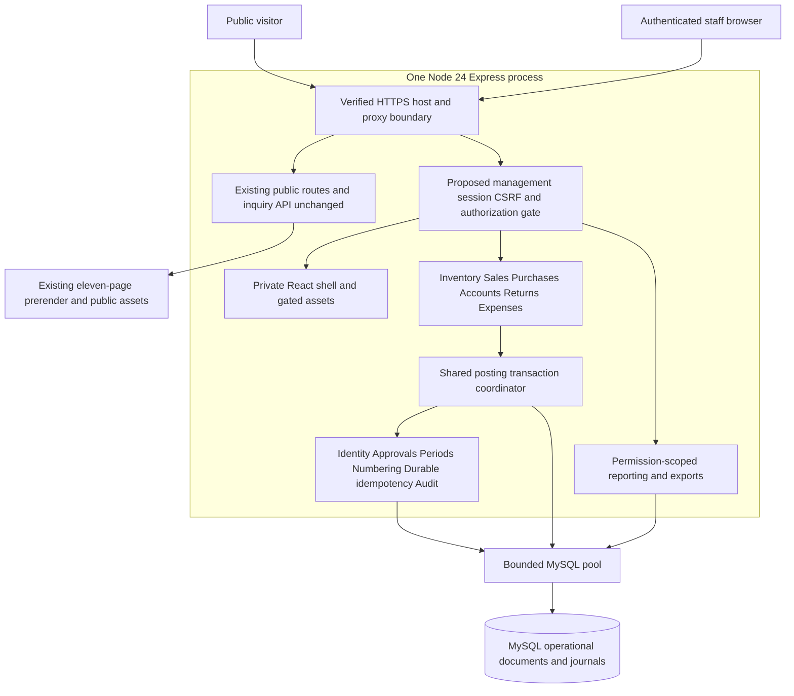

# Proposed system architecture and transaction contracts

All future components and defaults in this document are **PROPOSED**. R-01/R-02/R-26–R-28 constrain them. P2.0 changes no application code, API, dependency, build configuration or database state.

## Modular monolith and public/private boundary

Propose `/management/*` for the private React area and `/api/v1/management/*` for protected APIs, keeping `/api/v1/public/inquiries` unchanged. These are documentation names, not registered routes. Private routing must precede the public fallback when eventually implemented. The current public registry/sitemap and Vite build remain unchanged now; future private code uses a separately scoped entry/build output served only after authentication, with protected route fallback and no-store. Do not append management/admin routes to public prerendering or expose admin scripts, financial bootstrap JSON, source files, uploaded evidence or exports through the public static allowlist.

Modules own their domain validation/tables and expose command/query services. They do not write another module's journals directly or open nested independent database transactions. A shared posting service passes one transaction-scoped connection to cooperating stock, party, money, numbering, approval and audit services. Identity, masters and policy are shared controlled dependencies; no public inquiry automatically creates a customer, order or sales record. Shared database does not mean shared department visibility.

## Exact representations (P-02, not approved policy)

| Value | Proposed representation / validation |
| --- | --- |
| Quantity | DECIMAL(20,6), unit-specific scale 0–6; positive movement input, signed nonzero journal delta; no silent rounding |
| Unit selling/purchase rate | DECIMAL(18,6), decimal-string API, proposed positive value; free/zero-rate policy unresolved |
| Posted amounts/manual GST/balances | DECIMAL(20,2), signed balance/delta where applicable; debit/credit magnitudes nonnegative |
| Intermediate multiplication | Exact decimal product up to 38 digits/12 fractional places, bounded before final monetary rounding |
| Calculation policy | Proposed round-half-up per line to 2 decimals, subtotal sum of rounded lines, manual GST accepted at exact allowed scale; owner/accountant must approve |
| Currency | Proposed one configurable base currency (PKR suggested for review), stored on documents/ledgers/accounts; reject cross-currency matching/transfer; no invented FX |
| Time | UTC DATETIME(6) instants plus business_date DATE and explicit Asia/Karachi display/number-year timezone; no ambiguous local timestamps |

Use a maintained decimal implementation or rigorously tested exact integer/string arithmetic; do not perform authoritative quantity/rate/tax/amount calculations with JavaScript Number. Do not cast MySQL decimal strings to float. Validate scale/overflow before insert: [MySQL exact-value behavior](https://dev.mysql.com/doc/refman/8.4/en/precision-math-expressions.html) can still round excess fractional digits. Currency, precision limits and rounding are implementation gates, not settled company rules.

## One posting protocol

1. Authenticate and authorize initial intent; parse allowlisted fields/decimal strings and expected document version. Build the complete resource plan, including originals/receipts/cheques affected by corrections.
2. Acquire one pool connection and begin an InnoDB transaction. Claim `(actor, operation, idempotency_key)` with normalized request hash. Same key/hash returns an authorized committed result; same key/different intent conflicts. The claim/result commits with the business effects, never separately as an orphan 'started' task.
3. Lock guards in the global order below. Recheck active user, current action/scope permissions, policy/period/cutoff, exact approved versions/effects and document state. Do not trust a UI role or expired cached approval.
4. Aggregate all stock and money deltas, calculate exact financial effects and lock all required balances. Validate no negative inventory under any condition, exact money-deficit authorization if needed, ledger class/currency, allocations, dispatch/return cumulative claims and source provenance.
5. Insert one posting batch for each source action/version, immutable journals/effects and required allocation/cheque events; update balance caches in the same transaction. A linked immediate vendor-payment document shares the purchase transaction, with its own unique batch/number.
6. Under the last sequence locks, assign official document numbers only to documents that can post. Update POSTED state/revision, append audit and record safe durable result references. Commit; only then return an issued number/success. If anything fails, roll back all effects.
7. Release connection in finally. On deadlock/lock timeout roll back the **whole** transaction, use a bounded retry (proposed at most three attempts with jitter) and re-read approval/permissions/balances. Do not replay only a failed statement. No lock is held during user input, rendering, external email or PDF generation.

Global lock order (all modules must use the same ranking): command/idempotency key → policy/period/user authorization guards in fixed key order → **all** target/original business-document guards by ID → customer-ledger/vendor guards by type/ID → cheque/receipt-specific guards by ID → money-account guards by ID → stock `(item,bucket)` guards → document-type/year sequences. Any newly discovered lower-ranked resource requires rollback and a complete replanned attempt, not ad hoc reverse-order locking. Unique-index conflicts are handled as rollback/retry or existing-result lookup. Precreate zero stock/ledger guards with masters; explicitly upsert missing optional guards through the same controlled order. Grant/revocation, approvals, allocation changes, opening batches and corrections participate in these conventions too.

[MySQL locking reads](https://dev.mysql.com/doc/refman/8.4/en/innodb-locking-reads.html?ff=nopfpls) support the proposed indexed FOR UPDATE guards. Plain read-then-write or process-memory mutexes cannot protect concurrent process restarts/alias instances. Propose READ COMMITTED with explicit parent locks for aggregate constraints, pending verified engine/version and concurrency tests; do not rely on phantom-free SUM queries or an unreviewed default isolation level. Database CHECK/UNIQUE/FK constraints supplement service checks.

## Durable idempotency and reconciliation

Unique posting-source/action/version and effect keys prevent duplicate journals even if a user retries with another request key. The durable command record survives app restart; a lost HTTP response is resolved by authorized key/document lookup. Financial posting deduplication is not the public inquiry's W05 process-local cache. Do not expire a financial source's uniqueness protection merely because an HTTP retry window passed. Response replay is subject to current visibility permissions and never discloses revoked private data.

Journals are authoritative; balance rows/caches are their atomic projections. Reconciliation compares stock bucket sums, customer D−C, vendor C−D, money signed movement totals, per-document financial totals, active allocations and cheque custody/recognition. Record mismatch investigations and authorized correction batches; no silent cache repair. A read report can show a consistent as-of snapshot/cursor without locking all stock. No complete accounting general ledger, valuation, trial balance or statutory financial statement is implied.

## Annual numbering and periods

Use one sequence row per `(document_type, calendar_year)` and unique official numbers; prefixes such as DC/PUR/PRD/MC/RCP/VP/SR/ADJ/EXP/TRF and RRC for the proposed linked physical return-receipt type are **proposed**, not company terminology. Draft IDs are unrelated internal keys. Proposed numbering year is server posting instant in Asia/Karachi, even if business_date is earlier; Q-10 requires owner confirmation. Allocate counter updates inside the successful posting transaction under a row lock. A rolled-back candidate is never displayed/issued; reuse of an uncommitted candidate is not reuse of an issued number. A committed number stays attached forever, including corrected records. Allow auditable gaps for externally issued/reserved historical numbers; no operator reseeding or reuse. Preserve approved legacy paper reference separately, not by rewriting issued numbers.

Period/cutoff controls gate business_date independently of numbering year. Normal posting before cutover or into a closed period fails. An explicit currently permitted administrator period/backdate authorization must identify the exact transaction/date/reason and be audited; whether any financial period may reopen remains an owner decision. Such authorization still cannot violate stock, receipts or sequence uniqueness.

## Hosting and operations

Keep one mandatory app process, bounded MySQL pool (initial five connections proposed), finite queue/acquisition/query/transaction deadlines, indexed bounded reports and paginated exports. Aggregate pool budgets across any apex/www processes. Use on-demand or explicitly authorized scheduled reconciliation, not a permanent worker. Large exports must be bounded or safely chunked without a long write transaction; no durable state only in process memory or overwritten release directories.

Reuse W06 security/deployment constraints and backup planning. Hostinger entitlement, proxy sanitation, database version/limits/backup coverage are unresolved; no new readiness claim. Sessions and financial operations require durable MySQL before implementation acceptance. Run reviewed migrations explicitly with separate privileges; never on every startup. DB outage should fail private actions safely without changing public inquiry semantics or making the public app require a connection during P2.0. Private module enablement/failure isolation needs tests in a later milestone.
