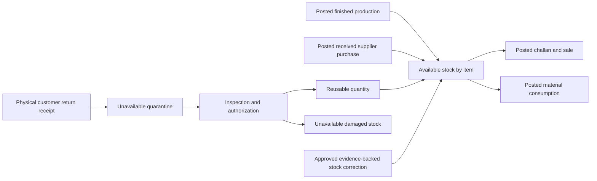
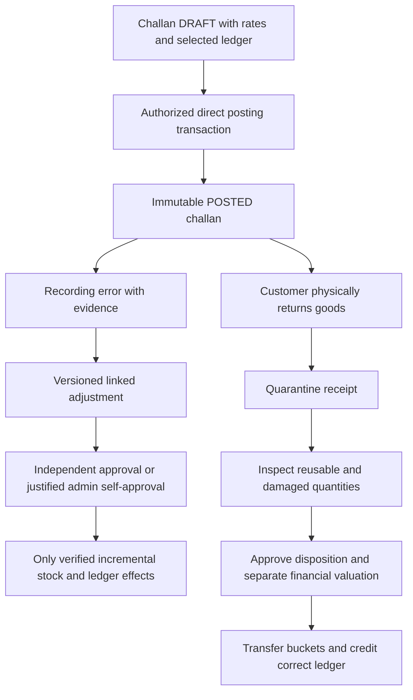

# Business workflows and common lifecycle

Confirmed effects are R-03–R-24. State names and coordination below are **PROPOSED**, shared across all fifteen documents. No workflow is implemented.

## Terminology and states

An **item** has a fixed base stock unit; a **variant** is a finished item defined by the four identity dimensions. **Available stock** excludes quarantine/damaged stock. A **document** captures business intent; a **posting batch** atomically records its effects; **journals** are append-only stock, party or money facts. An **allocation** connects an already recognized receipt credit to a challan; it is not a new payment. A **correction** fixes recording errors; a **return** records physical goods coming back.

| State | Meaning / permitted next action |
| --- | --- |
| DRAFT | Editable/versioned, no posting effects or official number. Ordinary permitted transactions may post directly; sensitive ones submit. |
| SUBMITTED | Exact version frozen for review; approver may APPROVE or REJECT. Withdrawal/edit returns to DRAFT and invalidates prior approval. |
| APPROVED | Decision binds version/hash, scope and values; post only after fresh permission/balance/period checks. Relevant edits invalidate approval. |
| REJECTED | No effects; reason retained. Revision creates a new DRAFT version and resubmission. |
| POSTED | Immutable payload and official number; journals exist. Only linked subsequent documents/events may change effective balances. |
| CORRECTED | Derived display label on a POSTED original when a linked approved correction exists; not a mutable replacement state or reversal of its history. |

Abandoned drafts may be marked WITHDRAWN with history; they never become posted cancellations. No deletion/reissue of posted challans is mandatory. Direct posting bypasses SUBMITTED/APPROVED only for ordinary actions whose policy permits it; it never bypasses shared invariants.

Returns add operational states REQUESTED → RECEIVED → INSPECTED → AUTHORIZED → POSTED; the financial return document still uses the common approval/posting lifecycle. A separate linked return-receipt document posts physical custody to quarantine, has its own posting number/batch and no customer credit. Thus a financial return draft does not itself mutate stock: its RECEIVED display derives from an immutable posted child receipt. Partial inspection stays quarantined until the complete disposition for that return is approved; final POSTED disposition requires unresolved quantity zero and transfers reusable/damaged quantities plus the approved customer credit. Cheques add PENDING → DEPOSITED → CLEARED or DISHONOURED; details are in [accounts](P2-0-accounts-cheques-expenses.md). Neither lifecycle silently posts a financial event twice.

## Inventory flow



Production records finished output without consuming raw materials. Consumption records eligible raw/component/packing usage without creating bottles. Purchases require actual receipt evidence; an invoice not yet received must remain draft/unposted under the proposed V1 workflow until receiving policy is approved. Caps, seals and packing described on a challan do not silently consume their stocks; their separate consumption policy must be confirmed.

## Supplier purchase posting

```mermaid
sequenceDiagram
  participant Staff
  participant Purchase as Purchase service
  participant Tx as Shared transaction coordinator
  participant DB as MySQL
  Staff->>Purchase: Post received purchase plus optional payment
  Purchase->>Tx: Version, permission, idempotency, payment intent
  Tx->>DB: Begin; lock policy, document and affected balances
  Tx->>DB: Validate quantities, vendor payable and money availability
  alt Invalid or missing deficit approval
    Tx->>DB: Roll back every effect
  else Valid
    Tx->>DB: Add stock, vendor payable and unique optional settlement
    Tx->>DB: Deduct paying account only for immediate payment
    Tx->>DB: Number, audit, document POSTED, durable result
    Tx->>DB: Commit once
  end
  Tx-->>Staff: Posted result or safe rejection
```

Full/partial/credit purchases use one gross vendor payable and zero/one immediate settlement; the remainder is derived, not another payable. Later vendor payment is a separate document. Immediate settlement cannot also be entered as an expense. Supplier returns/corrections require owner policy before implementation; no automatic stock reversal is proposed.

## Challans, corrections and returns



Never use an adjustment to bypass return inspection, rewrite a sale or duplicate stock. Multiple corrections/returns lock the original line and cumulative entitlements before validating remaining quantities. A wrong physical shipment is not the same as a wrong recorded variant.

## Receipts, payments, transfers and expenses

Cash/bank/cash-holder receipt: one source document, one selected customer ledger credit, one account increase. Allocation may follow immediately or later with no new journal credit. Vendor payment reduces vendor payable and the paying account once. Transfer has equal opposite account movements and no party/expense entry. Expense has one paying-account deduction and one expense fact. Each uses the shared posting coordinator and current permissions; any money-deficit exception is exact-transaction approved.

Approvals/openings/correction policy, unavailable-source-reference handling and cheque credit timing are not optional UI toggles. The [approval design](P2-0-security-approvals.md), [opening plan](P2-0-opening-migration.md) and [decision register](P2-0-decisions-and-open-questions.md) specify the remaining gates.
