# Proposed MySQL logical data model

**PROPOSED logical design only. No DDL, migrations, ORM, connection or database test exists in P2.0.** Business constraints come from R-01–R-30; precision, enum names and entity consolidation await approval. This model is single-company Unique Plastic Industry, not a multi-company ERP. Verify actual MySQL-compatible engine/version and CHECK/FK/transaction support before implementation.

## Shared dictionary contracts

All proposed tables are catalogued below; inherited profiles are part of each table definition. IDs are internal BIGINT UNSIGNED, serialized as strings to avoid JavaScript integer loss. UUIDs are used for external request/session identifiers where stated; official business numbers are separate. UTC timestamps use DATETIME(6), business dates DATE. All FKs are indexed and RESTRICT history-breaking deletes; no cascading deletion of posted records. Referenced inactive masters remain readable to authorized history views.

- **M (master):** PK id, normalized unique code unless row says otherwise; active flag; created_at/updated_at and created_by/updated_by FKs to users; version; changes referenced by protected audit_events subject_kind/subject_id. No money/stock column editable by master-data commands.
- **C (control/link):** stated PK/unique keys; created_at/created_by FK and version when mutable; active/revoked/effective lifecycle as stated; audit_events link control changes. Immutable decisions/events use creation time only, no update/delete API.
- **D (document extension/line):** FK document_id to business_documents; line PK id and unique `(document_id,line_no)` unless header PK is document_id; created_at/created_by and document-version ownership. DRAFT editable only through parent version checks; POSTED rows immutable. Header lifecycle/audit/posting timestamps inherited from parent, not independently posted.
- **J (journal/event):** PK id unless stated; immutable created_at/actor_id FK; posting_batch_id FK (or explicit event provenance stated); nonempty effect_key unique within batch, index `(posting_batch_id,effect_key)`; no mutable status. Corrections append linked rows, never update amounts. Audit references via batch and event subject; no unnecessary duplicate customer data.
- **B (balance projection):** stated composite/owner PK; exact balance and revision, updated_at; last_posting_batch_id FK; no independent business status or manual amount edit. Authoritative journal recomputation must equal the cache.

Use quantity **Q = DECIMAL(20,6)**, rates **R = DECIMAL(18,6)**, posted monetary **A = DECIMAL(20,2)** and currency CHAR(3). Q scale by unit and A rounding remain Q-09; signed deltas/balances versus positive input magnitudes are explicit. Debit/credit journal values are nonnegative A with exactly one positive side. Intermediate exact multiplication is bounded as specified in [architecture](P2-0-architecture.md). Strict SQL settings do not remove the need for pre-insert scale validation.

Audit events use an explicit document FK where available, plus `(subject_kind,subject_id)` for master/control subjects. The latter is a protected application reference, **not a fictitious polymorphic database FK**. Each table's audit and timestamp obligations are supplied by its profile. This avoids circular audit FKs while retaining searchable source/batch references.

## Identity and policy tables

| Table / profile / transaction owner | Keys, fields and FKs | Uniqueness, indexes and lifecycle |
| --- | --- | --- |
| users / M / Identity | id; login_key; password_hash; authorization_version; enabled; last_login_at | U(login_key); I(enabled,id); disabled users retained; initial administrator bootstrap audited with a documented system actor before normal user-created FKs apply |
| roles / M / Identity | id; role code/name; approved department scope | U(code); active/inactive; role title is not approval authority |
| permissions / M / Identity | id; action code; resource/field/export scope description | U(code); active/inactive; no negative-stock bypass permission |
| user_roles / C / Identity | PK(user_id,role_id), both FKs; granted_by FK users; granted_at/revoked_at | I(role_id,user_id); revoked grants retained through audit/versioned grant history; all changes lock user's auth guard |
| role_permissions / C / Identity | PK(role_id,permission_id), both FKs; scope policy; active | I(permission_id,role_id); change bumps affected user authorization versions; audit before/after |
| sessions / C / Identity | id; user_id FK; token_hash; csrf binding; issued/last_seen/idle_expires/absolute_expires/revoked_at; auth_version | U(token_hash); I(user_id,revoked_at), I(absolute_expires_at); active/expired/revoked derived; never raw cookie tokens |
| approval_decisions / C immutable / Approval | id; document_id FK; document_version/effect_hash; scope; approver_id FK; decision, reason/self_approval_reason; policy_id FK; expected original revision/account/deficit snapshot where applicable | I(document_id,document_version,scope); unique approval request ID; append APPROVE/REJECT/INVALIDATE/CONSUME events linked to prior decision; no mutable 'approved=true' shortcut |
| company_policies / C immutable versions / Administration | id; policy_key/version; effective_at; approved_by FK users; reviewed settings including cheque policy/rounding/cutoff; reason | U(policy_key,version); I(policy_key,effective_at); current policy selected by controlled active pointer/version guard; old versions retained |
| company_policy_heads / C / Administration | PK policy_key; current_policy_id FK company_policies; revision; created_at/updated_at and actor FKs | One precreated lock guard per policy key; activation changes this pointer atomically; lock head before reading active version so new policy insertion cannot race a posting |
| business_periods / C / Administration | id; start_date/end_date; state; cutoff/reference policy_id FK; closed/reopened actor/time | U(start_date,end_date); I(state,start_date); OPEN/CLOSED plus controlled exceptions; overlapping periods prohibited by service under policy guard |

## Master data tables

| Table / profile / owner | Keys, fields and FKs | Uniqueness/indexes / constraints |
| --- | --- | --- |
| units / M / Inventory masters | id, code, label, allowed_scale 0–6 | U(code); I(active,id); changes cannot reinterpret transacted items |
| item_categories / M / Inventory masters | id, fixed category code and label | U(code); four permitted business groups; no user-created negative-stock exception category |
| bottle_types / M / Inventory masters | id, canonical code/label | U(code); active/inactive; no abbreviation inference |
| sizes / M / Inventory masters | id, canonical code/label | U(code); no implicit conversion formulas |
| qualities / M / Inventory masters | id, canonical code/label, reviewed definition | U(code); owner taxonomy required |
| colours / M / Inventory masters | id, canonical code/label | U(code); preserve historic display snapshots |
| inventory_items / M / Inventory masters | id; category_id/unit_id FKs; optional bottle_type_id/size_id/quality_id/colour_id FKs; allowed scale inherited unit | U(code), U(four variant FKs) for complete finished variants; service requires all four for finished, none for non-finished; I(category_id,active,id); no packing identity field |
| customers / M / Customer master | id, code, restricted contact/address fields | U(code); I(active,id); ledger classes in separate rows; duplicate party review, no guessed automatic merging |
| vendors / M plus B payable projection / Vendor master and Posting | id, code, restricted contact fields, payable_cache A/revision/last_batch FK | U(code); I(active,id); payable maintained only by posting, not normal master edit |
| money_accounts / M plus B / Accounts master and Posting | id, code, label, account_kind CASH/BANK/CASH_HOLDER/CHEQUE_HOLDING/CHEQUE_CLEARING; currency; nonspendable flag; balance_cache A/revision/last_batch FK | U(code); I(kind,active,id); ordinary negatives blocked, specific money exception only; custody balances reconcile to cheques |
| expense_categories / M / Accounts master | id, code, label, approval policy_id FK if set | U(code); I(active,id); excludes disguised employee advances/payroll |

Finished-variant uniqueness must handle nullable keys explicitly: the proposed rule requires all four FKs for finished items, so MySQL NULL uniqueness cannot allow duplicate incomplete variants. Non-finished items use their own unique item code. No hidden zero or empty master dimension represents 'unknown'.

## Shared documents and posting controls

| Table / profile / owner | Keys, fields and FKs | Uniqueness/indexes / lifecycle |
| --- | --- | --- |
| business_documents / C / Owning domain plus Posting | id; document_type; temp UUID; official_number nullable; business_date/time; status; version/payload_hash/effective_revision; reason/remarks/external_reference; policy_id FK; created/updated/submitted/posted actor FKs/timestamps; correction parent FK if applicable | U(temp_uuid), U(official_number); I(type,status,business_date,id); DRAFT/SUBMITTED/APPROVED/REJECTED/POSTED; CORRECTED is derived; posted payload immutable |
| document_events / J / Owning domain | document_id FK, from/to lifecycle, version/hash, reason; event may reference approval_decision_id FK | I(document_id,id); unique command/effect prevents duplicated transitions; audit for all version/state changes; non-posting events use controlled event provenance without inventing a financial batch |
| document_sequences / C / Numbering | PK(document_type,calendar_year); last_value; updated_at/actor; timezone policy_id FK | Composite PK is lock guard; issued numbers never reset/reused; separate type/year rows |
| posting_batches / C immutable / Posting coordinator | id; source_document_id FK; action; approved_version; command_id FK idempotency_records; posted_at/actor; linked_batch_id FK for correction/reversal | U(source_document_id,action,approved_version); I(posted_at,id); exists only on committed source action |
| idempotency_records / C immutable committed / Posting coordinator | id; actor_id FK; operation/key; normalized_request_hash; source_document_id FK; safe result references, committed_at | U(actor_id,operation,key); I(source_document_id); no financial dedup expiry while source history exists; claim/result commit with effects |
| audit_events / J / Audit service | actor/session FK; document_id/batch_id FK nullable; subject_kind/id; action/version; reason; restricted before/after changes; correlation; UTC time | I(document_id,id), I(subject_kind,subject_id,id), I(actor_id,created_at); append-only; pre-post failures/identity events have event provenance rather than fake business batches |

For document_events, audit_events and pre-post return_inspections, a posting_batch_id may be null for nonposting events; immutable command/event ID is then unique. Financial/stock/money journal rows always require a real posting batch. Header subtype/type-FK consistency and allowed transitions require the owning service; SQL constraints alone cannot enforce every cross-table rule. Linked immediate purchase settlements are separate documents within the same connection/transaction, not nested commits.

## Inventory and sales tables

| Table / profile / owner | Keys, fields and FKs | Uniqueness/indexes / semantics |
| --- | --- | --- |
| stock_balances / B / Stock service | PK(item_id,bucket), item FK; bucket AVAILABLE/QUARANTINE/DAMAGED; quantity Q | I(bucket,item_id); CHECK quantity ≥ 0 where supported; precreated guards, no location claim |
| stock_movements / J / Stock service | item_id FK; bucket; signed_delta Q; source_line_kind/id; unit_id FK snapshot; reverses_movement_id FK optional | U(batch,effect_key); I(item_id,bucket,id); nonzero delta; source line application reference is typed/validated, not arbitrary client input |
| production_lines / D / Production | document FK; item_id/unit_id FKs; quantity Q; item labels snapshot | U(document,line_no); I(item_id,document_id); finished only, positive input; header common PRD document |
| consumption_lines / D / Consumption | document FK; item_id/unit_id FKs; quantity Q; operational description | U(document,line_no); I(item_id,document_id); eligible material/component/packing only; header reason mandatory |
| stock_adjustment_lines / D / Inventory adjustment | document FK; item/bucket/unit; signed delta Q; measured_before/after Q; evidence refs; original movement FK when correcting | U(document,line_no); I(item_id,document_id); approval and verified provenance; no negative result |
| challan_details / D header / Sales | PK document_id FK; customer_ledger_id FK; address/vehicle/driver/dispatch snapshot; subtotal/manual_gst/total A; currency; rounding_policy_id FK | I(customer_ledger_id,document_id); manual tax creator/evidence; source common DC lifecycle |
| challan_lines / D / Sales | document FK; item/unit FKs; four variant snapshots; packing_description; quantity Q; rate R; amount A; exact calculation snapshot | U(document,line_no); I(item_id,document_id); packing not item FK; immutable posted sale facts |
| challan_adjustments / D header / Sales adjustment | PK document_id FK; original_challan_id FK business_documents; original_effective_revision; approval snapshot | I(original_challan_id,document_id); header type ADJ with subtype CHALLAN |
| adjustment_lines / D / Sales adjustment | document FK; original_challan_line_id FK nullable for header metadata; kind; affected_field; typed before/after/effect snapshots; signed quantity/amount/GST deltas Q/A | U(document,line_no); I(original_challan_line_id,document_id); whitelist typed corrections, no arbitrary patch code; physical provenance required for stock effects |
| sales_returns / D header / Returns | PK document_id FK; original_challan_id FK nullable only approved exception; customer_ledger_id FK; operational_state; valuation/tax A; inspector/authorizer refs | I(original_challan_id,document_id); REQUESTED/RECEIVED/INSPECTED/AUTHORIZED/POSTED operational states; financial lifecycle inherited |
| return_receipts / D header / Returns receiving | PK document_id FK; return_document_id FK sales_returns; received_at/receiver_id FK users; evidence key | I(return_document_id,document_id); independent RRC number and common POSTED lifecycle; batch adds quarantine/claims only, no party credit |
| return_lines / D / Returns | document FK; original_challan_line_id FK nullable approved exception; item/unit FKs; received/reusable/damaged/unresolved Q; approved_credit_base/tax A | U(document,line_no); I(original_challan_line_id,document_id); final posting requires unresolved = 0 and reusable + damaged = received; item/unit frozen once a posted receipt references line |
| return_claims / C immutable events / Returns | id; receipt_document_id FK return_receipts; return_line_id FK; original_challan_line_id FK; CLAIM/RELEASE; positive quantity Q; prior_claim_id self-FK for release; receipt_event_key | U(receipt_event_key); I(original_challan_line_id,id); original-line/document lock serializes cumulative signed claims; final disposition does not claim again; release only for approved evidenced receipt correction, never to recycle already returned entitlement |
| return_inspections / J / Returns | return_line_id FK; inspector_id FK; inspected_at; reusable/damaged/unresolved Q; evidence/valuation recommendation | U(batch,effect_key) for posted receipt/disposition events; pre-post inspection has unique inspection event ID/provenance; I(return_line_id,id); revisions append and invalidate approval |

Return quantity snapshots are versioned pre-post input/effective views. A posted return_receipts child owns physical quarantine/claim effects and its own number; the sales_returns parent may still await financial inspection/approval without itself being a stock-mutating draft. Receipt/claim facts are immutable. Partial inspection appends evidence but keeps goods quarantined; final all-or-nothing disposition requires all received units classified. After final POSTED return, changes require linked approved correction documents, never a later mutation of its inspection/amount fields. Over-return exceptions require a defined policy, evidence and authorization; a nullable FK alone does not authorize them. Source-line references always resolve to a valid line of the required document/customer/ledger/type.

## Purchases, parties, money and opening tables

| Table / profile / owner | Keys, fields and FKs | Uniqueness/indexes / lifecycle |
| --- | --- | --- |
| purchase_details / D header / Purchases | PK document_id FK; vendor_id FK; supplier_reference; received_at; total A/currency; immediate_payment_document_id FK nullable | U(immediate_payment_document_id); I(vendor_id,business reference); duplicate supplier-reference policy reviewed; received purchase only posts |
| purchase_lines / D / Purchases | document/item/unit FKs; received quantity Q; rate R; amount A; item/price snapshots | U(document,line_no); I(item_id,document_id); no automatic stock valuation |
| vendor_payments / D header / Accounts | PK document_id FK; vendor_id/account_id FKs; amount A/currency; source_purchase_id FK nullable; immediate_purchase_id FK nullable only for immediate settlement; payment method/reference | U(immediate_purchase_id) with ordinary nullable uniqueness, not a fictitious partial index; I(source_purchase_id,document_id), I(vendor_id,document_id); later payments may reference the same purchase; parent lifecycle |
| customer_ledgers / M key plus B / Party ledger service | id; customer_id FK; ledger_class; currency; balance_cache A/revision/last_batch FK | U(customer_id,ledger_class); I(customer_id,id); active/inactive; never combines GST/NON_GST |
| customer_ledger_entries / J / Party ledger service | ledger_id FK; debit/credit A; business_date; currency; original_entry_id FK optional; cheque recognition/source refs | U(batch,effect_key); I(ledger_id,business_date,id); customer balance D−C; no allocation credit |
| vendor_ledger_entries / J / Party ledger service | vendor_id FK; debit/credit A; business_date/currency; original_entry_id FK optional | U(batch,effect_key); I(vendor_id,business_date,id); payable C−D |
| customer_receipts / D header / Accounts | PK document_id FK; ledger_id/account_id FKs; amount A; method/currency/reference; recognition derived from linked journal/cheque events rather than editing the posted receipt | I(ledger_id,document_id); one ordinary recognized credit per receipt enforced by unique source-effect; cheque association in cheques; later clearance never edits original receipt fields |
| allocation_events / J / Allocation service | receipt_document_id/challan_document_id FKs; ADD/RELEASE; positive amount A; releases_event_id FK nullable; reason; credit source eligibility snapshot | I(receipt_document_id,id), I(challan_document_id,id); release cannot exceed its ADD remainder; lock parent ledger and documents for aggregate limits |
| money_movements / J / Money service | account_id FK; signed_amount A; currency; business_date; cheque_id/transfer_document_id FKs nullable; original_movement_id FK optional; exception approval FK nullable | U(batch,effect_key); I(account_id,business_date,id); one account journal authority; cheque custody excluded from spendable funds |
| transfers / D header / Accounts | PK document_id FK; source/destination account FKs; amount A/currency | I(source_account_id,document_id), I(destination_account_id,document_id); accounts differ; equal opposite effects, no income/expense |
| cheques / C operational register / Accounts | id; receipt_document_id FK nullable for opening; ledger_id FK; bank/instrument/date/holder; amount A/currency; policy_id FK snapshot; state; holding/clearing/bank account FKs; opening_line_id/opening_ledger_line_id FKs to opening_lines nullable; opening_credit_included/recognized_amount A | U(receipt_document_id), U(opening_line_id) when present; I(state,cheque_date,id), I(ledger_id,id); controlled instrument duplicate key policy Q-07; PENDING/DEPOSITED/CLEARED/DISHONOURED; state projects immutable events |
| cheque_events / J / Accounts | cheque_id FK; from/to state; amount A; evidence; recognition/reversal entry FK nullable; opening recognition reference FK nullable | U(cheque_id,event_request_key); I(cheque_id,id); unique actual credit recognition/reversal effect and valid prior state; no policy rewrite |
| expenses / D header / Accounts | PK document_id FK; category_id/paying_account_id FKs; description/reference; amount A/currency; source-purpose evidence | I(category_id,document_id), I(paying_account_id,document_id); exactly one money outflow; no second vendor settlement or employee advance |
| opening_batches / D header / Cutover | PK document_id FK; unique cutover_generation; cutoff_date; reviewer/approval refs; reconciliation_hash; freeze/release metadata | U(cutover_generation); I(cutoff_date,document_id); common lifecycle; active/released generation selected under company policy guard, not a partial unique-index assumption |
| opening_lines / D / Cutover | document FK; target_kind; inventory item/bucket or customer ledger/vendor/money account FK as applicable; CHEQUE_CUSTODY subtype linked from cheques.opening_line_id instead of a reverse FK; signed amount A or quantity Q; unit/currency; private evidence key | U(document,target-kind,target-key,bucket) where appropriate; I(document_id,target_kind); exactly one typed target or instrument subtype; excludes payroll/advances and double cheque inclusion |

Consolidations: generic business_documents + typed extensions avoid sixteen independent lifecycle/numbering/approval implementations. Production/consumption use shared headers and typed lines. Expenses/transfers/receipts/vendor payments are typed document extensions, not duplicate header/posting systems. B caches live on the corresponding guarded master/ledger where practical. No general-ledger/chart-of-accounts, stock-cost layer, payroll or historical-import tables are introduced.

Opening lines' optional FKs need exactly-one-target validation, typed checks and controlled construction, not free polymorphic IDs. Insert opening header/lines, then cheques referencing their custody line and, if credit was already recognized, the reviewed customer opening line. No reverse opening-line-to-cheque FK is used, so no deferred constraint or insertion cycle is needed. An opening customer net balance can include prior cheque credit without creating a fictional credit row. Custody opening effects are emitted once per instrument and reconciled to holding/clearing totals; do not also post the same custody totals as independent money-account openings.

## Entity relationships

```mermaid
erDiagram
  USERS ||--o{ USER_ROLES : assigned
  ROLES ||--o{ USER_ROLES : grants
  ROLES ||--o{ ROLE_PERMISSIONS : contains
  PERMISSIONS ||--o{ ROLE_PERMISSIONS : defines
  USERS ||--o{ SESSIONS : owns
  COMPANY_POLICIES ||--o{ COMPANY_POLICY_HEADS : active_version
  BUSINESS_DOCUMENTS ||--o{ APPROVAL_DECISIONS : reviewed
  BUSINESS_DOCUMENTS ||--o{ POSTING_BATCHES : posts
  IDEMPOTENCY_RECORDS ||--o{ POSTING_BATCHES : deduplicates
  POSTING_BATCHES ||--o{ AUDIT_EVENTS : evidenced
  UNITS ||--o{ INVENTORY_ITEMS : measured
  ITEM_CATEGORIES ||--o{ INVENTORY_ITEMS : groups
  INVENTORY_ITEMS ||--o{ STOCK_BALANCES : projects
  INVENTORY_ITEMS ||--o{ STOCK_MOVEMENTS : moves
  POSTING_BATCHES ||--o{ STOCK_MOVEMENTS : records
  BUSINESS_DOCUMENTS ||--o{ PRODUCTION_LINES : produces
  BUSINESS_DOCUMENTS ||--o{ CONSUMPTION_LINES : consumes
  CUSTOMERS ||--o{ CUSTOMER_LEDGERS : separates
  CUSTOMER_LEDGERS ||--o{ CUSTOMER_LEDGER_ENTRIES : journals
  BUSINESS_DOCUMENTS ||--o| CHALLAN_DETAILS : specializes
  BUSINESS_DOCUMENTS ||--o{ CHALLAN_LINES : dispatches
  CHALLAN_LINES ||--o{ RETURN_CLAIMS : limits
  BUSINESS_DOCUMENTS ||--o| SALES_RETURNS : specializes
  SALES_RETURNS ||--o{ RETURN_LINES : contains
  SALES_RETURNS ||--o{ RETURN_RECEIPTS : physically_received
  RETURN_RECEIPTS ||--o{ RETURN_CLAIMS : reserves_entitlement
  RETURN_LINES ||--o{ RETURN_INSPECTIONS : inspected
  CHALLAN_LINES ||--o{ ADJUSTMENT_LINES : corrects
  VENDORS ||--o{ PURCHASE_DETAILS : supplies
  BUSINESS_DOCUMENTS ||--o{ PURCHASE_LINES : receives
  VENDORS ||--o{ VENDOR_LEDGER_ENTRIES : journals
  CUSTOMER_LEDGERS ||--o{ CUSTOMER_RECEIPTS : receives
  CUSTOMER_RECEIPTS ||--o{ ALLOCATION_EVENTS : matches
  CHALLAN_DETAILS ||--o{ ALLOCATION_EVENTS : matched
  CUSTOMER_RECEIPTS o|--o| CHEQUES : instrument
  CHEQUES ||--o{ CHEQUE_EVENTS : transitions
  MONEY_ACCOUNTS ||--o{ MONEY_MOVEMENTS : journals
  MONEY_ACCOUNTS ||--o{ EXPENSES : pays
  EXPENSE_CATEGORIES ||--o{ EXPENSES : groups
  BUSINESS_DOCUMENTS ||--o| OPENING_BATCHES : initializes
  OPENING_BATCHES ||--o{ OPENING_LINES : reconciles
```

ERD is a navigation subset, not a substitute for the full dictionary: four variant masters, stock-adjustment lines, document/sequence/period/policy controls, transfers and approval/audit links are defined in the tables above. Cardinalities represent optional business participation, with typed FK identity checked by owning services. Document-type/year sequence allocation, stock/party/money balance equations, aggregate allocations, cumulative return claims and policy-dependent cheque effects are cross-row invariants detailed in the owning documents and acceptance matrix; they cannot all be reduced to column CHECKs.
