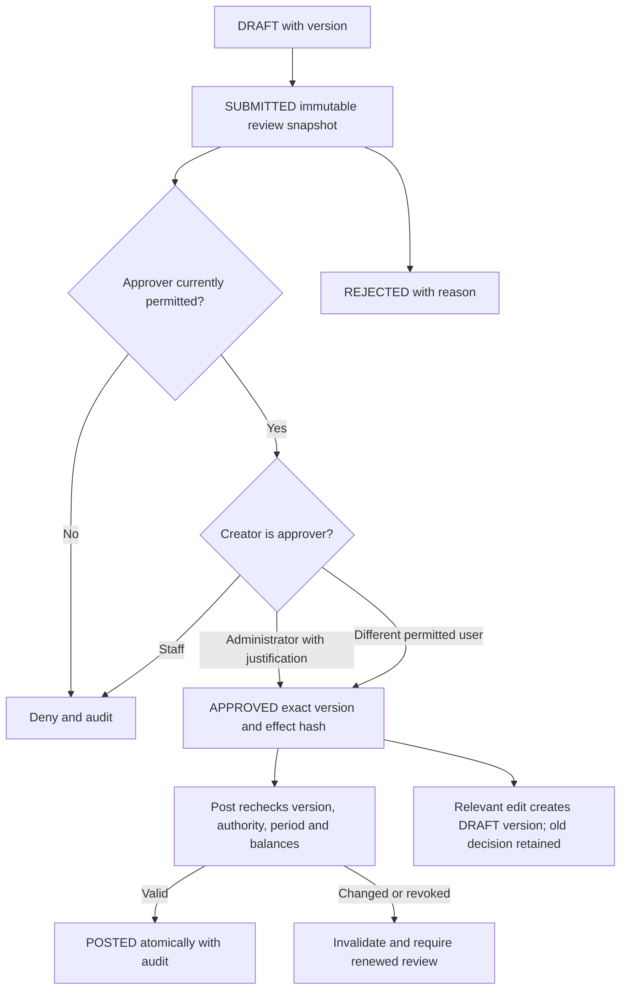

# Security, permissions and approvals

Department visibility and approval rules R-23/R-24 are **CONFIRMED**. Authentication technology/defaults below are **PROPOSED** and require threat review, hosting measurements and separate implementation authorization.

## Authentication and session design

Use maintained password/session/CSRF libraries, not custom protocols. Propose Argon2id with unique salts and parameters benchmarked for constrained hosting; follow [OWASP password guidance](https://cheatsheetseries.owasp.org/cheatsheets/Password_Storage_Cheat_Sheet.html) when selecting maintained implementation and costs. No dependency is added in P2.0. Bound simultaneous expensive login work and combined account/IP throttling so hashing cannot exhaust the process. Use generic login failures and timed lockout/backoff with administrator recovery, not permanent unauthenticated lockout that lets an attacker disable users.

Propose opaque, cryptographically random session cookies with hashed token records in MySQL, rotation at login/privilege elevation and no URL/localStorage bearer tokens. Set Secure, HttpOnly and SameSite=Lax (or stricter after workflow testing), no Domain attribute, and a carefully scoped path. A __Host- cookie needs Path=/; the private cookie path and that prefix must not be combined inconsistently. Proposed idle expiry 30 minutes and absolute lifetime 8 hours require owner approval. Logout revokes the server-side record and clears the cookie; password/reset/role/account-disable actions revoke affected sessions and bump an authorization version. No public self-registration is proposed. Recovery method and optional MFA for privileged users require review; do not depend on the currently disabled public SMTP sender.

[OWASP session guidance](https://cheatsheetseries.owasp.org/cheatsheets/Session_Management_Cheat_Sheet.html) informs fixation prevention, expiry and cookie controls. Revalidate current user/session/permissions at sensitive authorization and posting, not solely at login. Coordinate privilege revocation and posting through a locked user/authorization guard so a revocation committed first denies the action. No cached role title permits bypassing this check.

Cookie-authenticated mutations need a maintained synchronizer-token CSRF defense plus validated Origin/Fetch Metadata and no mutation through GET. SameSite is defense in depth, not the sole CSRF mechanism. See [OWASP CSRF guidance](https://cheatsheetseries.owasp.org/cheatsheets/Cross-Site_Request_Forgery_Prevention_Cheat_Sheet.html). Apply protection to login/logout and exports that change state. Do not replace public inquiry origin behavior with management-session middleware.

## Proposed role defaults and visibility

| Department | Default permitted view/actions | Denied by default |
| --- | --- | --- |
| Inventory | Item masters, stock, permitted production/consumption/inspection drafts and posting according to assigned actions | Customer balances, bank/cash-holder balances, sales prices unless expressly granted, financial exports |
| Sales/Dispatch | Necessary customer contact/delivery fields, challan quantities/rates and ordinary challan posting | Unrelated customer balances, vendor payables, bank accounts and expenses; sensitive correction approval |
| Accounts | Separate party ledgers, purchase amounts/payables, receipts/vendor payments, cheques, money accounts, expenses and financial reports | Automatic inventory mutation or production authority; may invoke an approved purchase workflow whose stock effects are controlled by its service |
| Administrator | Full oversight, user/policy/master administration with explicit sensitive-action permissions and audit | No negative-stock override, unlogged self-approval, deletion of posted history or credentials disclosure |
| Read-only/Auditor | Proposed explicit report/document grants if approved | All mutations; privileged columns unless separately granted |

Roles seed permissions; approval authority is a separately assigned action/scope permission, not inferred from a role label. Distinguish draft/edit, submit, post, approve, return-inspect, account-exception, opening-post, policy-change, backdate and export permissions. Backend query predicates and response serializers enforce document/field/column restrictions, including nested lookups, aggregates and print/download endpoints. Route hiding is not authorization. Do not leak account totals through dashboard counts/errors. Grant management-user access only to known users, with no public website identity coupling.

## Approval workflow

Approval record binds document ID/version, effective-original revision where applicable, normalized payload/effect hash, policy version, scope/action, approver, decision time, reason and self-approval justification. Deficit approval additionally binds account/debit/expected balance/resulting deficit. Approval does not reserve inventory or money and cannot guarantee availability later. A changed quantity/rate/GST/party/ledger/account/return valuation/physical evidence invalidates it; stale approval never authorizes a new payload.

Ordinary authorized challans directly post; do not impose a new blanket secondary approval. Sensitive stock/challan/financial adjustments and opening balances require approval. Return authorization is mandatory; precise return approver roles and expense thresholds remain unresolved. Staff may not approve their own sensitive transactions; administrators may with explicit justification and history. Proposed approval cannot be automatically inferred from merely having edited a draft.

## Audit, data and recovery security

Append-only audit events record actor/session/action/target/version, permitted before/after values or redacted change fields, reason, approval, posting batch, correlation and UTC time. Avoid copying full customer contacts into ordinary logs. Financial values required for restricted audit belong in protected database records, not application console output. Restrict audit reads/exports; runtime credentials cannot delete journals/audit, and migration/backup access is separate. Database administrators can still tamper: append-only permissions are not a claim of cryptographic tamper-proofness. Approved immutable off-host audit/backup copies and restore checks provide additional detection/recovery without custom encryption.

Use parameterized SQL, explicit field allowlists, response no-store, no stack/SQL/secrets in errors, bounded private JSON bodies/exports, CSP/XSS controls and least-privilege database users. Preserve W06 host/TLS/proxy validation; actual Hostinger proxy peers and sanitation remain unresolved. Backups and private uploads must never be served through public assets; use established encryption/secret-management facilities and authorized restore access. Retention, recovery objectives and audit-export redaction need owner approval. No password, session, endpoint or schema is implemented here.
