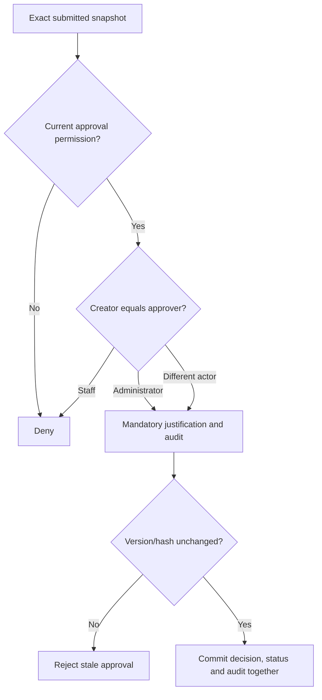

# Approval and period foundation

Approval authority is the distinct `business.approve` permission, granted by default only to Administrator. Editing/configuration does not imply approval. Generic internal services bind decisions to exact document ID, version and payload hash, record approver/time/justification and recheck current authority. No financial-module approval action is exposed.

```mermaid
stateDiagram-v2
  [*] --> DRAFT
  DRAFT --> SUBMITTED: Explicit submit
  SUBMITTED --> APPROVED: Current authority and exact version/hash
  SUBMITTED --> REJECTED: Required rejection reason
  APPROVED --> DRAFT: Relevant edit increments version and invalidates decision
  REJECTED --> DRAFT: Revise
  APPROVED --> POSTED: Future module only; not exposed in P2.2
  POSTED --> POSTED: Immutable; correction is a separate linked document
```

Staff self-approval is denied even when an approval permission is temporarily delegated in a rolled-back synthetic test. Administrator self-approval requires justification. Rejection reasons are mandatory. Edits invalidate old approval rows but preserve history. Future use rechecks approver account and permission; revoked authority does not authorize later effects. Audit-write failure rolls back the decision, document state and command ownership.

Business periods have nonoverlapping date ranges, open/closed status, version and an authorized audited change path. Dates stay fixed after creation. Reopening a closed period is blocked pending owner policy. No default period or company cutoff is seeded. Cutoff proposals create immutable PROPOSED policy versions only; neither a proposal nor changing period status creates financial/stock effects. Approved synthetic policies exist exclusively in dedicated tests. Actual cutover, backdating, closed-period exceptions and opening reconciliation remain later owner decisions.
