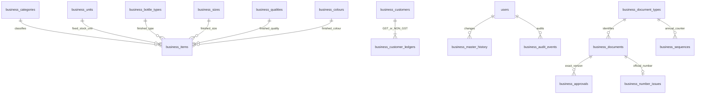

# Business schema

Migration: `202610210002_business_foundation.js`. All new tables use InnoDB/utf8mb4 with explicit primary/unique/foreign-key constraints. No original table is dropped or recreated. The migration inserts new permissions and role-permission links but does not change user records, password hashes, user-role assignments, sessions or existing audit rows. DDL is not assumed atomic; partial failure stops for reviewed forward repair. Down migration is intentionally disabled.

## Master relationships

Twelve master tables: categories, units, bottle types, sizes, qualities, colours, items, customers, vendors, money accounts, expense categories, document types. Supporting tables: customer ledger classifications, guard, master history, documents/events/links, sequences/number issues, posting batches/effect claims, idempotency, approvals, periods, policy versions and audit events. The exported `businessRuntimePrivileges` map is the exact 27-table business catalogue.

Items enforce four non-null dimensions for FINISHED_GOODS and no dimensions for the other three categories through a database CHECK. The four-column unique key prevents duplicate canonical finished variants independent of code or packing. A unique `(id,unit_id)` key supports future movement foreign keys that bind stock identity. Service writes never change unit/category/dimensions after creation. P2.3 must use that composite reference and retain the centralized write discipline; no stock-movement table exists yet.

Normalized ASCII codes are uppercase, bounded and unique. Foreign keys preserve references; there is no DELETE API or new business DELETE grant. Category codes are the four confirmed constants. Other masters have active/version/creator/editor/timestamps. Significant edits produce immutable revision snapshots and append-only audit evidence in the same transaction.

Customer/vendor records are physically separate. Customer subledgers use the unique `(customer_id,ledger_class)` key and enum GST/NON_GST, without balance columns or invented opening rows. Money accounts hold configurable metadata only. No monetary or quantity balances exist. Proposed future exact storage is quantity DECIMAL(20,6), rate DECIMAL(18,6), money DECIMAL(20,2); these are not approved financial rounding/currency policies and no float calculation or gratuitous amount column is introduced here.

Migration seed values are frozen inside the historical migration file, separate from the changing runtime catalogue. Future permission additions require a new additive migration rather than changing old replay behavior.
