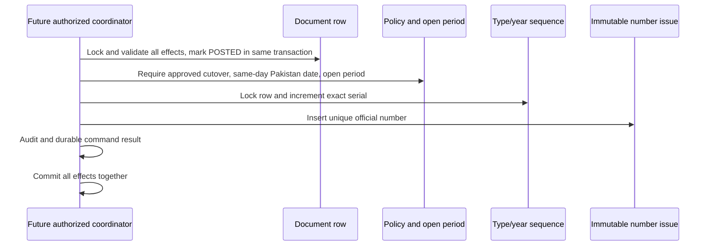

# Document numbering

The shared internal `issueNumber` service uses a row per `(type_id,calendar_year)` and a durable immutable issue row per document, with unique official number and `(type,year,serial)` keys. Counters use exact BigInt/string handling. Prefixes are configured by administrators and remain disabled until explicitly approved; no operational prefixes are seeded.

Format: configured prefix + calendar year + at least six serial digits. The year comes from the server instant in Asia/Karachi; rollover at 19:00 UTC on December 31 is tested. Type/year sequences are independent and never reseeded by an endpoint. Prefix changes are blocked after issue. Different types cannot use the same configured prefix through the service.

Draft creation never assigns an official number. P2.2 exposes no numbering or posting action. A future caller must validate effects and set POSTED inside the same transaction before issuing; any later failure rolls back the candidate counter, issue, status, audit and idempotency record. An uncommitted candidate is never an issued number; a committed number is immutable and cannot be reused. Linked corrections leave original issue rows intact.

Cutoff/prefix approval, period and same-day rules fail closed. No actual owner cutoff is selected. Backdated dates, closed/unconfigured periods and reopening are blocked; their year/authorization policy is unresolved. Policy proposals never activate cutover. Synthetic test-only approved policies and generic documents exercise concurrent issuance, annual reset, independent types, duplicate rejection, rollback and retry. No fake financial or inventory documents/numbers were created in upms.
