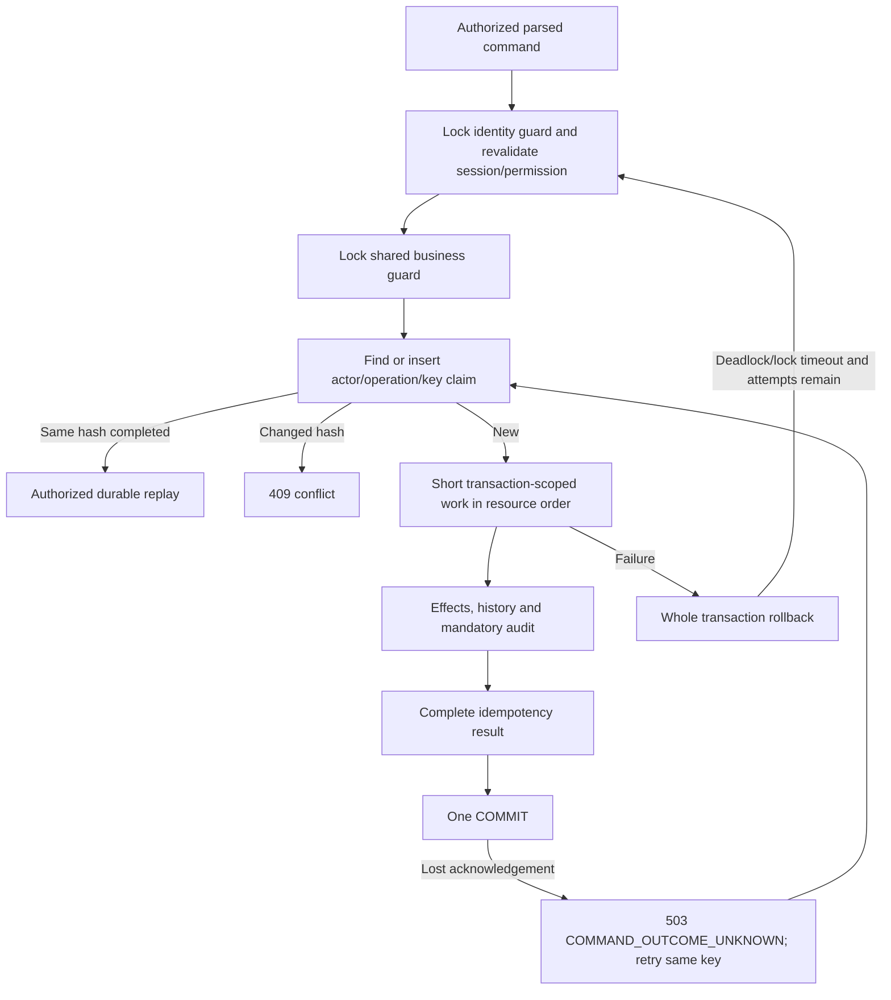

# Shared transaction infrastructure

`coordinate` owns one explicit InnoDB transaction and authorizes the live persisted session before reading any replay result. Isolation remains the verified session REPEATABLE READ; explicit locks protect invariants rather than relying on unlocked aggregate reads. The initial coarse lock strategy favors correctness at small local-development volume and must be measured before finer-grained P2.3 concurrency.

Lock order is identity guard → business guard → command ownership → policy/document/reference resources → type/year sequence. P2.1 identity changes participate in the same first guard, so a prior committed revocation denies a business command. All exposed business writes use this coordinator. Internal services never open a second independent transaction. Future resource additions must preserve this order; do not make network calls, render PDFs or request user input while locks are held.

At most three whole-transaction attempts are allowed for MariaDB deadlock/lock-timeout errors, with bounded jitter after rollback. Other errors are not automatically retried. Connection loss/timeout produces an uncertain-outcome response rather than blindly replaying a possibly committed effect. Same actor/operation/key and canonical payload hash resolves the durable result after restart. A changed payload with the same key conflicts. Failed transactions leave neither effects nor committed PENDING records. Results contain safe references, not private credential material.

Unique source `(document,version,action)` posting-batch and `(batch,effect_key)` constraints are reserved for future journals. They are schema-only prerequisites; P2.2 writes no real stock or monetary journal. Canonical command hashing is stable by key order and rejects floating-point values; no authoritative monetary arithmetic is implemented.

Real SQL tests establish rollback, concurrent command ownership, cross-process replay, source/effect uniqueness, real lock timeout/deadlock and lost COMMIT acknowledgement. The latter uses a local test TCP proxy that forwards COMMIT, observes the server OK, drops it before reaching the client, then proves authorized retry returns the committed result with one effect. No mock transaction is counted as SQL evidence.
