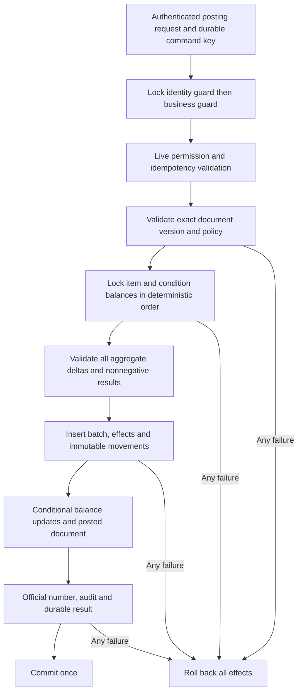

# Finished production

Inventory staff create a draft containing active finished bottle variants, exact quantities in each base unit, Pakistan business date, optional reference/remarks and mandatory reason. Save retains immutable line evidence for that version and does not change stock. Review precedes direct posting; ordinary production requires inventory.production.post and no approval.

Posting revalidates active item/unit/category, authorized initial state, quantities, owner inventory policy acceptance, current Pakistan date, approved prefix and open period. It credits AVAILABLE only. Materials, caps, seals and packing are not consumed automatically. No BOM, yield, costing or financial entry exists.

Lost COMMIT acknowledgement returns uncertain outcome; retrying the unchanged command retrieves its durable result. A new key cannot post a posted document again. The main migration is applied. Actual owner posting remains gated by explicit owner configuration and authorized item starting states.
