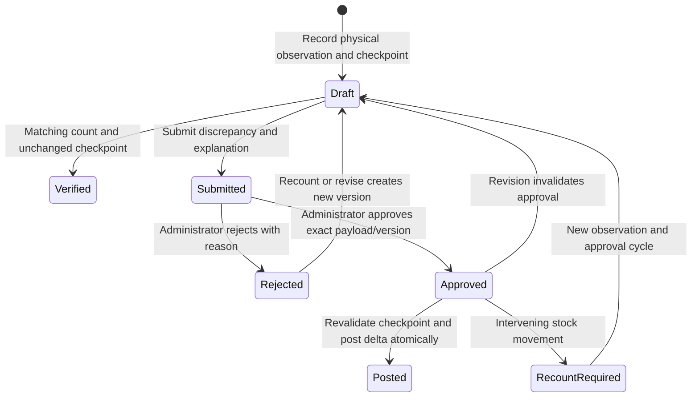

# Physical counts and adjustments

Each count line captures condition, exact physical quantity, expected system quantity, balance version, recorder and timestamp. Saving/submitting does not change stock. Duplicate item/condition count lines are rejected. Matching snapshots can close as VERIFIED with an audit event and no movement/number. The document extension records that closure; the generic business status remains DRAFT and UI explicitly labels it verified.

Every discrepancy, regardless of magnitude, needs administrator approval and administrator posting authority. Administrator self-approval requires a recorded justification. Staff cannot bypass this by receiving a generic approval permission. Posting checks the original approver remains enabled with current administrator authority. Stale quantity OR version rejects the count, including an intervening movement that returns stock to the old quantity.

Counts may explicitly observe quarantined/damaged stock, with separate approved adjustment journals. Condition reclassification and inspection/disposition actions remain disabled. This milestone does not authorize historical opening-stock shortcuts.
