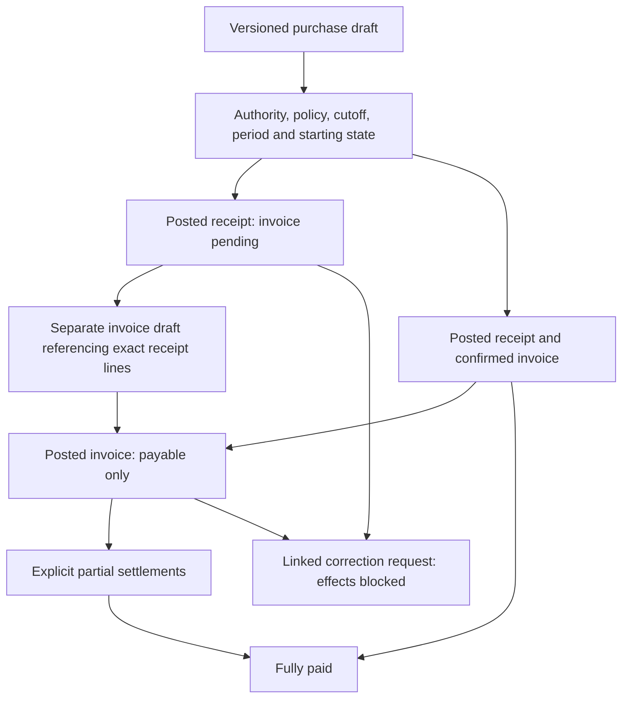

# Purchase receipt and invoice lifecycle

A DRAFT is versioned, unnumbered and has no effects. Accounts may create/revise eligible purchase drafts. Physical receipt, invoice date/reference and confirmed rates are separate fields. Pending-invoice lines must have null rates/amounts; confirmed invoice evidence requires all rates, positive quantities and exact amounts. No guessed price, tax, automatic unit conversion or default currency is accepted.

A receipt posts AVAILABLE quantity through the shared P2.3 stock lock/projection service and append-only purchase journal. It requires independently accepted inventory policy and authorized item starting states. Its own purchasing period/cutoff and numbering policy also apply. Finished purchases use the same finished-item balances as production; they never consume materials. Receipt lines are unique posting sources.

A later INVOICE references one posted receipt of the same vendor. Item/unit/quantity/order must match exactly. One invoice per receipt and one accepted supplier reference per vendor are enforced by unique constraints. It creates payable evidence without any stock movement. Later invoice confirmation never edits the original receipt or its null price evidence. Invoice/receipt splitting, partial invoicing and consolidated invoices are unsupported until reviewed.

Current implementation supports only separately approved current Pakistan dates. A historical supplier invoice date cannot be silently replaced; posting is blocked pending a supported timing policy. Draft evidence can retain that date. An original receipt displays its subsequently recognized invoice and outstanding balance through derived queries. POSTED source payload/lines/number remain immutable. Corrections are linked reviewable requests only; return-to-vendor, refunds, debit/credit notes and financial correction effects are disabled.
