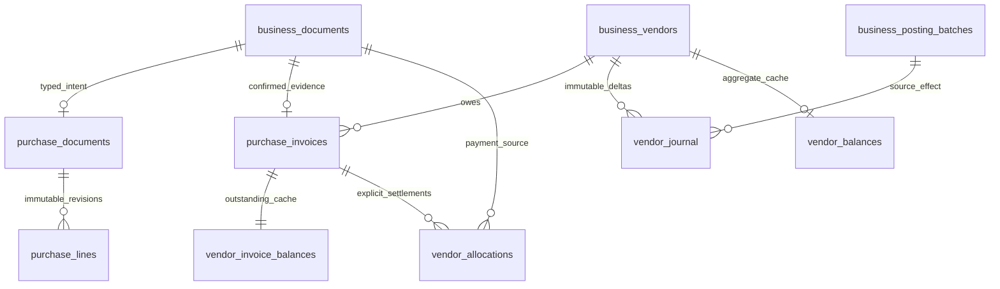

# Vendor payable ledger

Each explicitly authorized new vendor has an independent currency-bound balance. Existing/unverified vendors have no authoritative zero. The administrator must attest no prior financial history with reason; historical openings remain deferred.

One confirmed invoice creates one positive gross payable journal event and invoice outstanding. A payment creates negative payable events and positive allocations to specific invoices. Vendor balance = sum of journal deltas; invoice outstanding = original gross less explicit settlements = invoice journal sum. Payment allocations do not create another payable credit. All updateable caches are locked and maintained inside the source posting transaction.

Multiple payments and explicit multi-invoice payments are supported within one vendor/currency. Duplicate allocations, cross-vendor matching, surplus payments, negative invoice outstanding, supplier advances and unallocated credits are rejected. The vendor guard and deterministic invoice ordering operate under unchanged identity/business global guards. Immutable journals retain actor, posting time, document, batch and unique effect. Queries order journal history by posting ID/time and limit returned detail to 200 rows; they expose independent invoice outstanding and vendor total.

Supplier reference uniqueness is an explicit accepted policy: NFKC-normalized, trimmed uppercase reference within vendor. The database's utf8mb4_unicode_ci unique key can additionally equate accented/trailing-space forms; the conservative rejection behavior is documented. No company-wide or cross-vendor invoice number assumption is made. Changing this policy needs a later reviewed migration/contract, not silent duplicate acceptance.
