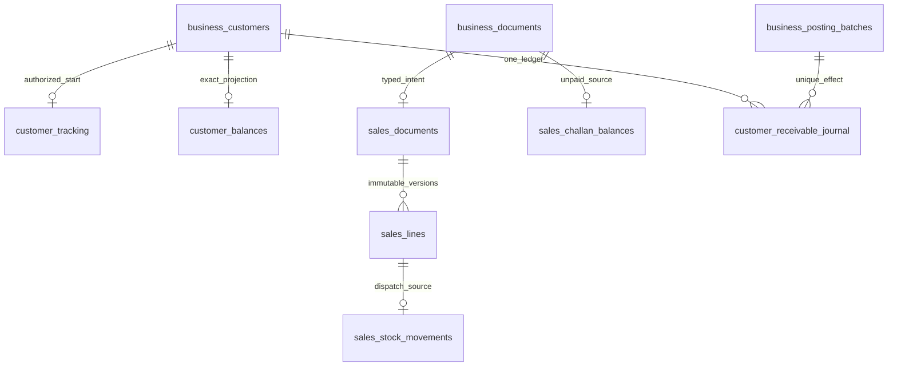

# Single customer receivable ledger

Each posted challan adds exactly one positive receivable debit. Immutable entries retain customer, source document, posting batch/effect, signed exact amount, currency, actor and UTC time. A customer has one currency-bound balance projection, not multiple financial classes. Challan-wise original and outstanding remain equal and append-only in this milestone: no payment, allocation, write-off or unsupported correction can reduce them. Future receipt/opening milestones require reviewed forward changes; no dormant payment endpoint is exposed.

Existing/new customers with no authorized starting state display UNVERIFIED/opening pending and null balance. Only Administrator with `customers.activate` can explicitly attest a genuinely new customer with no prior financial history, exact tracking version, currency and justification. That audited path creates authorized zero; missing history alone never does. Historical amounts remain P2.8. Existing legacy classification rows carry no P2.5 money and remain untouched/unused; new masters create no such rows.

Customer and item selectors/search, challan list and ledger reads have maximum100 rows and descending-ID cursor pagination (default50). Customer search, customer ID, business-date range and document/reference filters are parameterized and bounded. Ledger amounts are clearly unpaid. Inactive customers remain readable historically but cannot receive new challan posting. Reports include explicit currency and original/outstanding, without inferred payment status.

Reconciliation compares the customer cache with journal sum, each challan original with exact line totals and its sole debit, unpaid outstanding with original, unique stock effects with dispatched lines and batch/effect claims with source documents. It is read-only and never repairs mismatches. Inventory has no access to these endpoints or prices; price-free stock history redacts dispatch explanations to a stock-only label.
