# Delivery challan lifecycle

P2.5 owner authority supersedes P2.0's proposed dual customer classification. One operational receivable ledger is used. Existing legacy metadata is preserved, but new customer masters no longer create classifications and no such field is accepted or shown by Sales. Customer receipts, matching and cheques remain P2.6.

```mermaid
stateDiagram-v2
  [*] --> DRAFT
  DRAFT --> DRAFT: Versioned revision; no stock/debit/number
  DRAFT --> POSTED: Authorized Sales direct posting
  POSTED --> POSTED: Source, number and effects immutable
  POSTED --> CorrectionRequest: Separate linked document
  CorrectionRequest --> SUBMITTED: Reason and original version/hash
  SUBMITTED --> APPROVED: Administrator exact review
  SUBMITTED --> REJECTED: Justified decision
  APPROVED --> Blocked: Return/credit policy unresolved
```

Ordinary posting does not submit for approval and never requires `business.approve` or Administrator. Drafts hold active customer/version, current item/version, manual rates, quantities, fixed units, four-dimension variant/description snapshots, packing, remarks and references. Packing creates no variant. Only active FINISHED_GOODS and active fixed units qualify. Decimal strings are validated; unit conversion/free lines/implicit rounding are unavailable. Draft amounts use the supported technical arithmetic but are not operational policy approval.

Customer identity and document kind are fixed for a draft; edit quantity/rate/packing/reference/remarks through a new version. A wrongly selected customer requires another draft. Contact/item changes that advance master versions require review and a saved current version before posting. Old line revisions and events remain immutable. Draft cancellation is not introduced.

Private browser preview shows Unique Plastic Industry, DRAFT/unissued status or the official posted number, customer snapshot, date, item/variant/unit, quantities, manual rates, amounts and remarks. It is not a finalized customer print layout; production print/export remains disabled pending owner approval. No tax fields, placeholder values or tax-invoice language appear.
