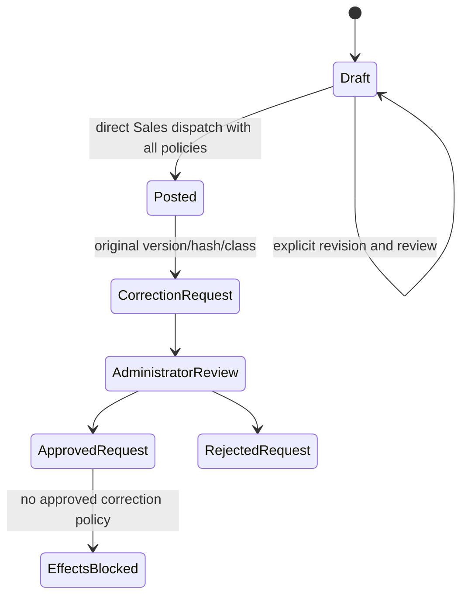
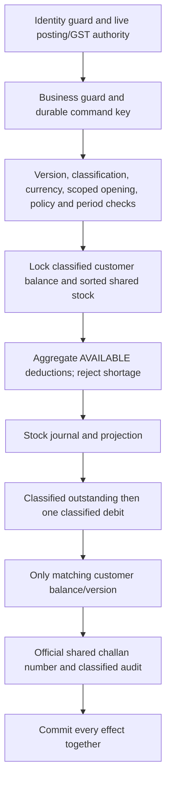

# Classified challan lifecycle and posting

Every new draft requires GST or NON_GST and an explicit exact GST amount. NON_GST accepts zero only. Draft class changes create a new version/hash and append-only classified snapshot; the user must save and review again. Posted classifications and amounts cannot be edited. Old unclassified drafts require explicit revision; old posted data blocks automatic cutover.

Posting uses P2.2 coordination/numbering, P2.3 shared stock locks and P2.4 exact-money arithmetic. No ordinary Administrator approval is introduced. No money-account event or receipt is produced by GST. Existing inventory/purchasing policy and stock conditions remain unchanged. The shared official sequence is explicitly selected in the synthetic policy; separate GST sequences and tax-invoice prefixes are not inferred.
