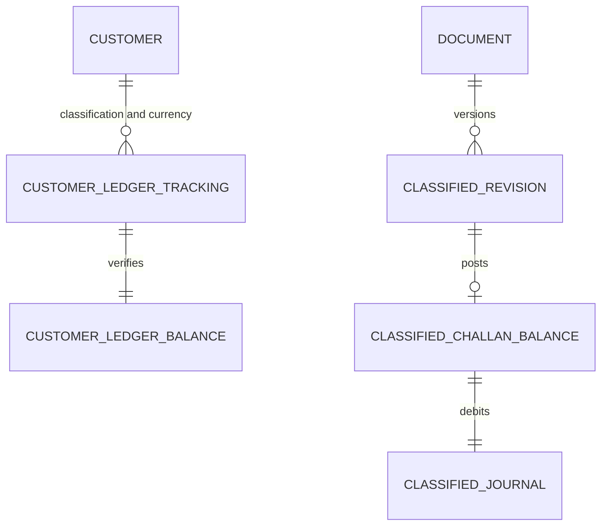

# Classified financial model

The client's P2.5A decision supersedes P2.5's tax-free single ledger. GST and NON_GST are fixed authoritative dimensions, not presentation filters. The new application reads/writes classified projections only; old financial rows remain read-only evidence. Legacy classification metadata is preserved and does not supply balances or opening verification.

| Table | Authority |
|---|---|
| sales_classified_revisions | Append-only document/version/classification/base/GST/receivable snapshot |
| customer_ledger_tracking | Customer/classification/currency opening authorization and state |
| customer_ledger_balances | Same composite key, exact balance and optimistic version |
| sales_classified_balances | One classified outstanding per posted challan, base/GST/original/policy/batch |
| customer_classified_journal | One classified customer debit per challan, immutable effect key/batch |
| sales_classification_policies | Append-only explicit synthetic manual-entry and numbering contract |

The journal composite foreign key must match its challan's customer, classification and currency. CHECK constraints enforce base plus manual GST equals receivable, NON_GST GST amount equals zero, and unpaid outstanding equals original. Runtime cannot update/delete source snapshots, journals or outstanding. No combined interchangeable balance is returned. Customer summaries show two distinct components with unverified/null values where required.

P2.6 shape is `futureAllocation` in `server/src/sales/classification.js`: customer ID, one ledger type, challan ID, exact outstanding, positive bounded allocation amount and payment reference. It validates shape/arithmetic only; it implements no receipt, money posting or implicit cross-ledger offset. Cross-classification allocation policy remains pending.
