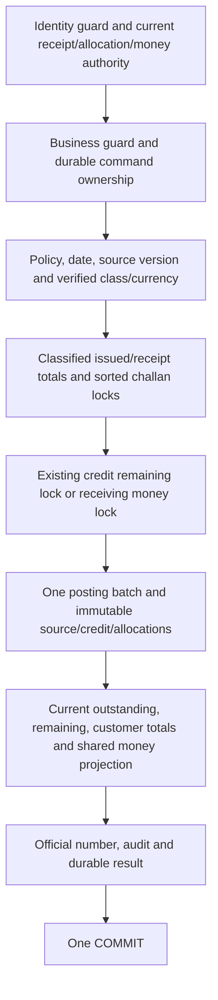

# Atomic receipt protocol

The coarse identity/business guards retain the global ordering across modules. Receipt-specific resources are locked deterministically; target challans are sorted by ID and all amounts revalidated. Whole-transaction retries handle real lock timeout/deadlock. A lost COMMIT acknowledgement yields uncertain outcome; retrying the same authorized key retrieves the committed result rather than producing another credit.

Real tests cover two receipts for one challan, two applications for one credit, simultaneous GST/NON_GST payments, several receipts into one account, process restart/key replay, actual SQL lock timeout/deadlock and a TCP proxy dropping the receipt COMMIT OK. Trigger failures at customer credit, allocations, money journal, audit and number issuance prove full rollback. One invalid allocation among valid targets leaves every customer/money amount unchanged.

One early test exposed receipt type authorization outside the retrying coordinator. It was moved under the identity guard, before idempotency lookup; the actual receipt timeout/replay cases then passed. No process-memory mutex, separate customer/money transactions or weakened stock rules are used. This is correctness evidence, not a production throughput claim.
