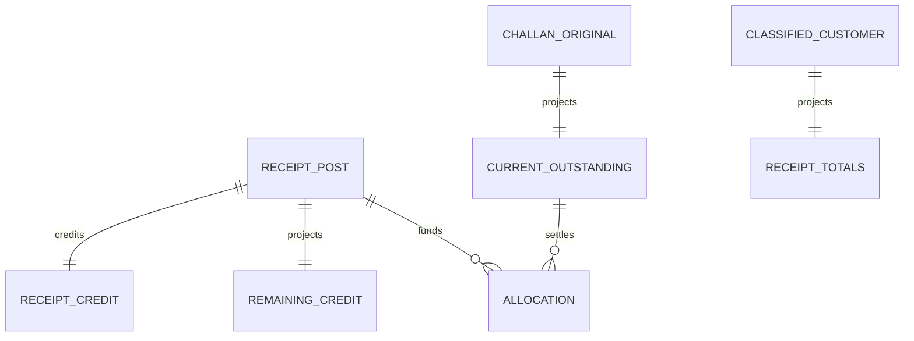

# Classified allocations and current projections

Every receipt belongs to exactly one customer/classification/currency scope. Composite FKs bind each credit to its receipt and each allocation to both that receipt scope and its challan scope. Cross-customer, cross-ledger and cross-currency matching are rejected. Duplicate challans within one document are rejected; allocation magnitudes are positive exact decimal strings.

P2.5A originals remain evidence: `sales_classified_balances.outstanding` stays equal to its original amount and `customer_classified_journal` stays positive immutable debit evidence. `customer_ledger_balances` continues to project issued debits, not current unpaid/net position. Its previous nonnegative constraint is retained. These old fields are not updated to conceal settlements.

Current authoritative reads combine immutable issued debits with the new receipt projections:

| Current value | Derivation |
|---|---|
| Challan outstanding | Immutable original minus valid immutable allocations, projected in customer_challan_outstanding |
| Gross unpaid | Issued customer debits minus total applied receipts |
| Unapplied customer credit | Received credits minus all valid allocations, projected by customer_receipt_totals/remaining |
| Net customer position | Issued debits minus total received credits; explicitly signed and labeled |

Sales posting initializes current challan outstanding in its existing transaction. Receipt posting/applications update only current settlement projections; no competing current balance is maintained in old original evidence. Sales document/list/ledger queries now return current outstanding and separately labeled gross/unapplied/net components. Both GST/NON_GST components remain independent; no authoritative combined interchangeable balance is returned.

Current versions/outstanding are revalidated under transactional locks. Two receipts cannot settle the same remaining amount twice. Historical customer/account starting states remain separately verified; absence never means a verified opening zero. No historical import is implemented.
