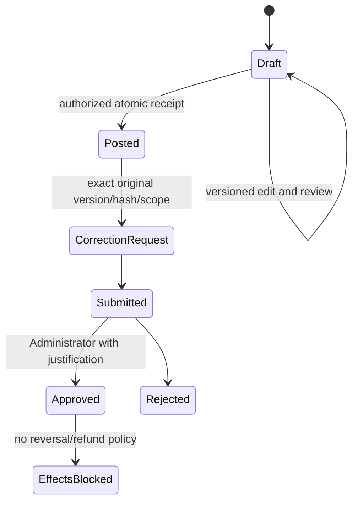

# Receipt lifecycle

Accounts with explicit create/post and money authority may post ordinary settled customer receipts directly. No Administrator approval is added to ordinary posting. Each draft states one customer, GST/NON_GST classification, currency/date, exact amount, compatible receiving account/method/version, external and payer references, remarks and explicit challan allocations. Review shows applied and unapplied amounts; no official number exists before posting.

Draft customer/classification/currency/source identity stays fixed; create another draft to choose another identity. Account/amount/allocations may be revised with expected document version. Posted evidence and official numbering are immutable. Corrections retain exact original scope/version/hash, duplicate-proposal protection and live approval authority. No financial reversal, refund, classification transfer, deletion or negative receipt endpoint exists.

Separate RECEIPT, APPLICATION and CORRECTION document types reuse P2.2 year/period/cutoff/numbering controls. Prefixes and shared-per-type numbering require explicit policy; no company prefix, cross-class numbering split or legal tax document is inferred. Only current Pakistan business date is supported pending backdating policy.
