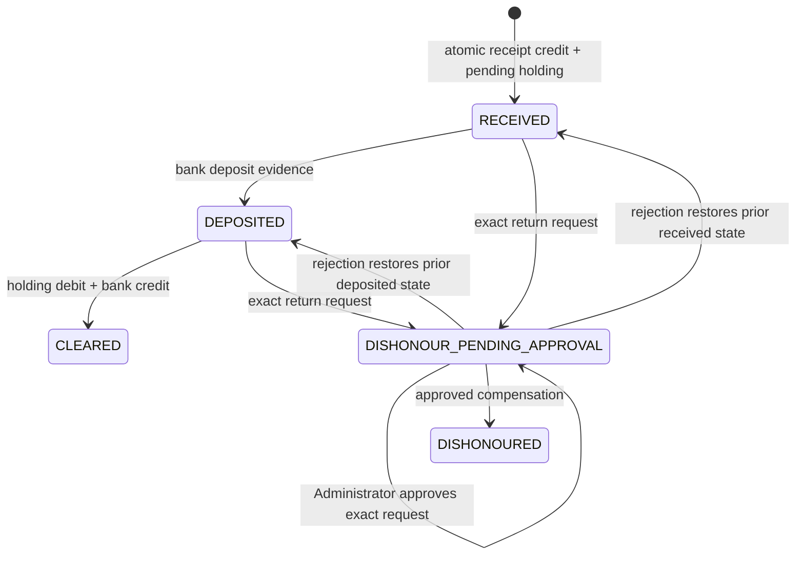

# Cheque state and custody

Deposit is required for clearance. Receipt-to-clearance, partial clearance, post-clearance bank reversal, replacement and re-presentation are unsupported. Each transition appends hashed evidence with actor/document/state-version and audit. Only cheque_states is a mutable projection. Rejection changes no money/customer balances and retains the rejected request. Review freezes additional applications of the pending credit; approval binds the dependency snapshot.
