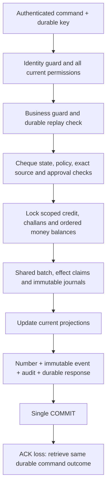

# Shared transaction flow

Receipt uses existing customer-money-credit. Clearance uses cheque-holding-clearance and cheque-bank-clearance. Dishonour uses cheque-holding-dishonour; source customer and allocation compensations have distinct effect claims. All money_journal deltas/before/after/version arithmetic remains exact decimal/BigInt. No unrelated bank balance subsystem or general ledger is added.
