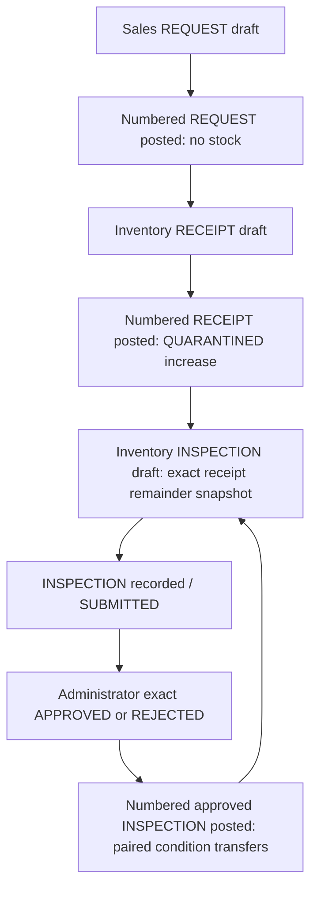

# Return document lifecycle and API contract

Shared POSTED sources never change. Unposted drafts can be revised with expected version; immutable return_lines revisions survive and old approvals become invalid. Unsupported corrections, scrapping, rehabilitation, exchanges and financial effects have no API path. Each posted inspection is an all-or-nothing pair set; partial inspection means a new document handles part of the current receipt remainder.

All endpoints are under `/api/v1/management/returns`, authenticated and protected by existing CSRF/origin middleware. Reads: GET configuration; sources (sanitized posted lines); documents with kind/challanId/customerId/cursor/limit; documents/:id; reconciliation. Writes require Idempotency-Key: POST configuration/accept; POST documents; PATCH documents/:id; POST documents/:id/submit, decide, post. No arbitrary status or posted-row editing endpoint.

Draft contract: kind REQUEST/RECEIPT/INSPECTION, challanId, customerId, inherited ledgerType, nullable requestId/receiptId, businessDate, customerReference, mandatory evidenceReference/notes/reason, lines (1-30), optional version. Each line: salesLineId, exact itemId/unitId, quantity, nullable requestLineId/receiptLineId/expectedVersion, reusable/damaged/remaining exact decimal strings. Requests/receipts require zero disposition values. One inspection receipt line per document; partial receipts and multiple request/receipt lines are supported. Unknown price, tax, variant or credit fields fail strict validation.

Post/submit body: version/reason. Decide: version/hash/APPROVED-or-REJECTED/reason. Current permissions precede durable replay.400/409 errors distinguish invalid source/scope/item/precision, exceeded return allowance, stale quarantine/source/version/approval and blocked real policy. Uncertain COMMIT returns503 COMMAND_OUTCOME_UNKNOWN; retry the same key and unchanged inputs.
